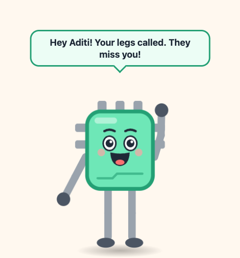
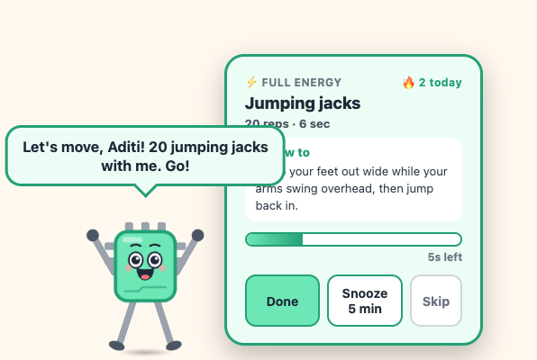
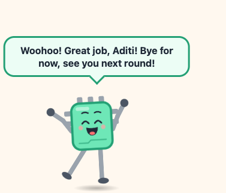

# Move 🏃‍♀️💻

**A cute desktop buddy that gets you off your chair.**

Every 30 minutes, a little gadget character walks onto your screen, knocks on
the glass, calls you by name and does a quick exercise with you: squats,
jumping jacks, push-ups and more. Ignore it and it gets impatient… then sleepy…
then it sits on your mouse pointer until you give in. 😄

Works on **Mac** and **Windows**. Free, open source, and private: everything
stays on your computer.

| Hey there! | Let's move! | Bye for now! |
|---|---|---|
|  |  |  |

---

## What it does

- ⏰ **Reminds you to move** every 20, 30, 45 or 60 minutes (you choose).
- 🚶 **A character walks onto your desktop**: you can still click everything
  around it. It never blocks your work, and **Skip** is always there.
- 🗣️ **Talks to you by name**, with blinking eyes, facial expressions and a
  mouth that moves with the words (works offline).
- 🏋️ **8 exercises done together**, with a tip, a rep count and a progress bar:
  squats, calf raises, arm circles, back arch, side stretch, jumping jacks,
  push-ups and mountain climbers.
- 🤖 **6 gadget friends** take turns, a different one every break: Chip the CPU, Clicky the mouse,
  Volt the battery, Mona the monitor, Keys the keyboard and Bass the headphones.
- 😤 **Ignore it at your own risk**: foot tapping, yawning, then it sits on your
  mouse pointer.
- 🦹 **Friday villain**: Overclock the grumpy server rack sometimes shows up on
  Fridays. Beat him with 10 push-ups!
- 🎄 **Holiday surprises**: Santa hats at Christmas, a pumpkin at Halloween,
  hearts for Valentine's Day and fireworks for New Year.
- 🔥 **Daily streak** of completed breaks, shown in the menu.
- 🔒 **Private**: your name and settings are saved only on your computer.
  Nothing is ever sent anywhere.

---

## Install it 

Go to the **[Releases page](https://github.com/AditiSonawane96/move/releases/latest)**
and download the file for your computer:

| Your computer | Download |
|---|---|
| Mac (Intel or Apple Silicon) | `Move-x.x.x-mac.dmg` |
| Windows | `Move-x.x.x-windows-setup.exe` |

### Mac

1. Open the `.dmg` file and drag **Move** into the **Applications** folder.
2. Open Move from Applications. You'll probably see a warning, see
   [below](#the-unverified-app-warning).
3. Type your name in the welcome window. Done!
4. Look for the little chip icon and the countdown (like `Chip · 29:59`)
   **in the menu bar at the top of your screen**. Move has no Dock icon.

### Windows

1. Run the `.exe` installer. You'll probably see a blue warning, see
   [below](#the-unverified-app-warning).
2. Follow the installer, then type your name in the welcome window.
3. Look for the little chip icon **in the system tray** near the clock. If you
   don't see it, click the **^** arrow. Tip: drag the icon onto the taskbar so
   it's always visible. Hover over it to see the countdown.

### The "unverified app" warning

Move is a free hobby project, so it isn't signed with a paid Apple or
Microsoft developer certificate. Your computer will warn you the first time.
That's expected. Here's how to open it anyway:

**Mac (macOS 15 Sequoia and newer)**

1. Open Move. When you see *"Move" Not Opened* (or *Apple could not
   verify…*), click **Done**.
2. Open **System Settings → Privacy & Security**.
3. Scroll down to the message about Move and click **Open Anyway**.
4. Enter your password, then click **Open Anyway** once more.

You only need to do this once.

*Older Macs (macOS 14 and earlier):* right-click (or Control-click) Move
in Applications, choose **Open**, then click **Open** again.

*Still blocked?* Open the **Terminal** app and run this, then try again:

```bash
xattr -dr com.apple.quarantine /Applications/Move.app
```

**Windows**

1. On the blue *"Windows protected your PC"* screen, click **More info**.
2. Click **Run anyway**.

### Using it

Click the tray / menu bar icon to:

- see the countdown and **today's streak**
- **Test nudge now**
- **Pause for 1 hour**
- change the **Interval**, **Mute voice**, **Change name…**
- open **Settings…** (character size, voice, "ask how I'm feeling", start at login)
- **Quit**

Move starts by itself when you log in, and pauses while your computer is
locked, asleep, or you've been away for 5+ minutes.

---

## Make it your own

### Add a new character

Every character is one small file in the [`characters`](characters) folder,
drawn with SVG in code (no image files).

1. Copy [`characters/chip.js`](characters/chip.js) to a new file, for example
   `characters/toaster.js`.
2. In the new file, change:
   - `id` to `'toaster'` (the same as the file name) and `name` to `'Toasty'`
   - `theme` (card colours) and `colors` (arms and legs)
   - `body`: the SVG drawing. The drawing area is 200 × 240. Keep the body
     **centred at x = 100**, with the bottom of the body around **y = 146**.
   - `joints`: where the arms and legs attach. Keep the hips at `y: 146` so the
     feet touch the ground.
   - `face` and `hat`: where the face and the Christmas hat go.
   - the last line: `window.MoveNudgeCharacter = ...`
3. Add it to the list in [`characters/index.js`](characters/index.js):

   ```js
   { id: 'toaster', name: 'Toasty' },
   ```

4. Try it right away (see *Developer tools* below):

   ```bash
   npm run nudge -- --character=toaster
   ```

Arms, legs, face, expressions and every exercise work automatically, because
all characters share the same skeleton (`src/renderer/nudge/rig.js`).

### Change what the characters say

All voice lines are in [`config/voice-lines.js`](config/voice-lines.js).
`{name}` is replaced with your name.

### Change the exercises

Edit [`config/exercises.js`](config/exercises.js): reps, seconds and tips.
New exercises also need an animation in
[`src/renderer/nudge/exercises.css`](src/renderer/nudge/exercises.css).

### Add a holiday

Copy a block in [`config/holidays.js`](config/holidays.js) and change the dates,
greeting, hat, sound or effect.

---

## For developers

You need [Node.js](https://nodejs.org) (version 20 or newer).

```bash
npm install
```

| Command | What it does |
|---|---|
| `npm start` | Run the app normally |
| `npm run dev` | Run with the 🛠 **Developer** menu (1-minute interval, preview characters, pretend it's Friday or a holiday, fast ignore reactions) |
| `npm run nudge` | Run and show a nudge right away. Add `-- --character=volt` to pick who comes |
| `npm run icons` | Redraw the tray icons and the app icon (`scripts/make-icons.js`) |
| `npm run dist:mac` | Build the Mac installer into `dist/` |
| `npm run dist:win` | Build the Windows installer into `dist/` (best done on Windows or by GitHub Actions) |

In the installed app, hold **Option** (Mac) or **Alt** (Windows) while clicking
the tray icon to see the Developer menu.

**Gallery page:** to see every character doing every move side by side, start a
local web server in the project folder:

```bash
python3 -m http.server 8745
```

Then open http://localhost:8745/src/renderer/nudge/gallery.html in your browser.

### How the project is organised

```
main.js              starts the app and connects everything
preload.js           the safe bridge between windows and main.js
src/main/            timer, tray menu, settings storage, windows
src/renderer/        what you see: welcome, settings, and the nudge scene
characters/          one file per character (SVG drawings)
config/              voice lines, exercises, holidays: easy to edit
scripts/             icon generator
build/               the app icon used by the installers
.github/workflows/   builds the installers on GitHub
```

### Making a release

Pushing a version tag builds the Mac and Windows installers on GitHub and
attaches them to a new Release automatically
([`.github/workflows/release.yml`](.github/workflows/release.yml)):

1. Change `"version"` in `package.json`, for example to `1.0.1`.
2. Commit, tag and push:

   ```bash
   git commit -am "Release 1.0.1"
   git tag v1.0.1
   git push && git push --tags
   ```

3. Watch it in the **Actions** tab on GitHub. After about 10 minutes, the
   installers appear on the **Releases** page.

---

## License

[MIT](LICENSE): free to use, change and share.
All characters are original artwork made for this project.
